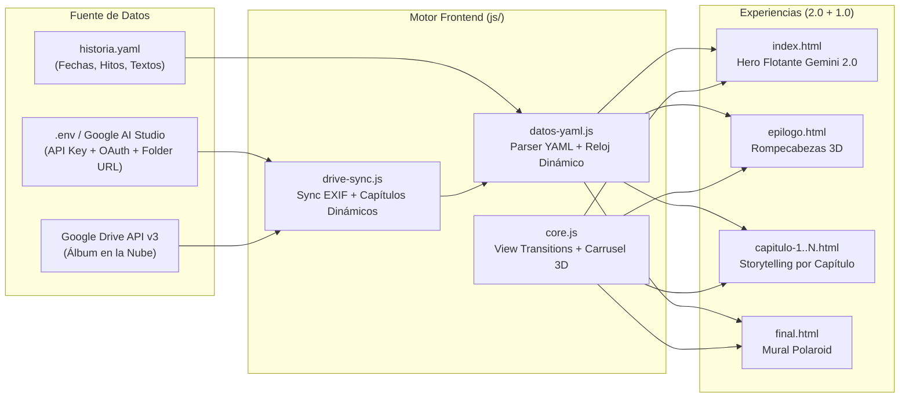

<div align="center">

# ✦ Unibody · Spatial Love Story

**Experiencia web interactiva de storytelling espacial, fotografías flotantes y memoria viva impulsada por YAML y Google Drive API.**

[](historia.example.yaml)
[](js/drive-sync.js)
[](historia.example.yaml)
[](index.html)

*Una historia en piezas · `fecha-date` — `fecha-date`*

</div>

---

## ✨ Descripción General

**Unibody · Spatial Love Story** fusiona dos conceptos visuales en una sola arquitectura sin dependencias externas, alimentada dinámicamente por un archivo maestro local (`historia.yaml`, basado en [`historia.example.yaml`](historia.example.yaml)) y sincronizada en tiempo real con **Google Drive API v3** ([`js/drive-sync.js`](js/drive-sync.js)):

1. **Portada Espacial Flotante (`index.html` · Concepto 2.0 inspirado en `gemini.google/about/`)**:
   - Web Component nativo `<gemini-love-hero>` con **8 fotografías flotando en el espacio**, paralaje 3D por scroll y puntero, desenfoque bokeh selectivo mediante CSS `:has()` y un escenario `<dialog>` con **animaciones geométricas FLIP**.
   - **Motor de 3 Contadores Automáticos en Tiempo Real** (configurados desde `historia.yaml`):
     - **El Primer Encuentro**: Tiempo exacto transcurrido desde `fecha-date` (`fechas.conocernos`).
     - **Oficialmente Novios & Tradición Mensual**: Meses cumplidos desde `fecha-date` (`fechas.novios`) y cuenta regresiva automática hacia el próximo aniversario mensual (`fechas.diaAniversarioMensual`).
     - **Nuestra Boda (Aniversario)**: Cuenta regresiva exacta hacia `fecha-date` (`fechas.boda`) con barra de progreso.
   - **Portales 50/50 por Capítulo y Constelación Completa**: Nubes flotantes interactivas con selector de episodios y filtros en vivo.

2. **Storytelling Inmersivo por Capítulo (`epilogo.html`, `capitulo-1.html`..`capitulo-4.html`, `capitulo.html`, `final.html` · Concepto 1.0)**:
   - **El Origen en 3D ([`epilogo.html`](epilogo.html))**: Rompecabezas 3D guiado por el scroll que ensambla 7 fragmentos en el espacio hasta formar la fotografía maestra (`fecha-date`).
   - **Capítulos Narrativos ([`capitulo.html`](capitulo.html))**: Portadas con *View Transitions API*, temas cromáticos adaptativos por etapa, cálculo automático del día de la relación por episodio y carruseles horizontales con perspectiva 3D.
   - **El Mural Polaroid ([`final.html`](final.html))**: Pared-álbum con todas las fotografías reveladas, chinchetas del color de cada capítulo y contadores de cierre.

---

## 🧭 Arquitectura del Sistema



---

## 📂 Estructura del Proyecto

```text
love-story/
├── .github/workflows/
│   └── deploy.yml           # GitHub Action para despliegue automático en GitHub Pages
├── .env.example             # Plantilla de variables de entorno (Google Drive API + OAuth)
├── historia.example.yaml    # Plantilla pública de configuración YAML (con fecha-date genéricas)
├── .gitignore               # Protege .env, historia.yaml y credenciales locales
├── index.html               # Portada Principal 2.0 (Hero flotante estilo Gemini + Contadores + Portales)
├── epilogo.html             # Capítulo de Origen: Rompecabezas 3D (fecha-date)
├── capitulo-1.html          # Capítulo I: El comienzo (fecha-date)
├── capitulo-2.html          # Capítulo II: Nuestros días (fecha-date)
├── capitulo-3.html          # Capítulo III: Frente al mar (fecha-date)
├── capitulo-4.html          # Capítulo IV: Para siempre (fecha-date)
├── capitulo.html            # Plantilla dinámica (?id=cap-5) para nuevos capítulos
├── final.html               # El Mural: Pared-álbum polaroid y contadores hacia fecha-date
├── css/
│   ├── core.css             # Sistema de diseño base, barra superior, carrusel 3D y visor
│   ├── home-gemini.css      # Estilos espaciales 2.0 (<gemini-love-hero>, bokeh :has(), FLIP lightbox)
│   ├── capitulo.css         # Estilos de portada, franja de fechas y episodios de cada capítulo
│   ├── epilogo.css          # Estilos del rompecabezas 3D guiado por scroll
│   └── final.css            # Estilos del mural de fotografías polaroid
└── js/
    ├── datos-yaml.js        # Parser de historia.yaml + motor de cálculo de fechas y aniversarios
    ├── drive-sync.js        # Conector dinámico con Google Drive API v3 y lector de .env
    ├── core.js              # Navegación con View Transitions, carruseles 3D y visor de pantalla completa
    ├── home-gemini.js       # Motor de la portada principal 2.0, contadores en vivo y portales de capítulos
    ├── capitulo.js          # Renderizador dinámico de capítulos con cálculo de días por episodio
    ├── epilogo.js           # Motor geométrico del rompecabezas 3D
    └── final.js             # Renderizador del mural polaroid y contadores de despedida
```

---

## ☁️ Configuración con Google Drive API, `.env` e `historia.yaml`

Las fotografías y las fechas reales no se almacenan en el repositorio público: las fotos se sirven desde **Google Drive** y las fechas reales viven en tu archivo local `historia.yaml` (excluido por `.gitignore`).

### 1. Preparar la carpeta en Google Drive
1. Crea una carpeta en Google Drive y compártela como **«Cualquier persona con el enlace (Lector)»**.
2. Crea adentro subcarpetas para cada etapa:
   - `epilogo` *(Foto maestra del rompecabezas 3D)*
   - `capitulo-1`, `capitulo-2`, `capitulo-3`, `capitulo-4`
   - **Capítulos dinámicos**: Si creas una carpeta llamada `capitulo-5 - Nuevo Capítulo`, el sitio creará automáticamente el **Capítulo V** en la barra de navegación, en la portada 2.0 y en `capitulo.html?id=cap-5`.
   - **Metadatos automáticos**: El conector lee la **fecha EXIF real** de cada foto para calcular qué día de la relación era, y toma el campo **Descripción** de Drive (o el nombre limpio del archivo) como pie de foto.

### 2. Configurar variables de entorno en local (`.env`)
Copia [`.env.example`](.env.example) a `.env` y agrega tus credenciales y el enlace de tu carpeta:

```dotenv
GOOGLE_DRIVE_API_KEY=<TU_API_KEY>
GOOGLE_DRIVE_FOLDER_URL=https://drive.google.com/drive/folders/<TU_FOLDER_ID>
GOOGLE_DRIVE_MODE=reemplazar
GOOGLE_DRIVE_CACHE_MINUTES=5
```

### 3. Configurar fechas y textos en local (`historia.yaml`)
Copia [`historia.example.yaml`](historia.example.yaml) como `historia.yaml` y reemplaza los marcadores `fecha-date` por tus fechas reales en formato ISO:

```yaml
fechas:
  conocernos: "fecha-date"
  novios: "fecha-date"
  diaAniversarioMensual: 1
  boda: "fecha-date"
```

### 4. Ejecutar en local
```bash
python -m http.server 8737 --bind 127.0.0.1
```
Abre `http://127.0.0.1:8737` en tu navegador. También puedes probar o cambiar la carpeta en vivo desde el botón **«☁ Conectar Google Drive»** en el pie de página.

---

<div align="center">
  <sub>Hecho con amor, recuerdo por recuerdo · <b>Unibody · Spatial Love Story</b></sub>
</div>
